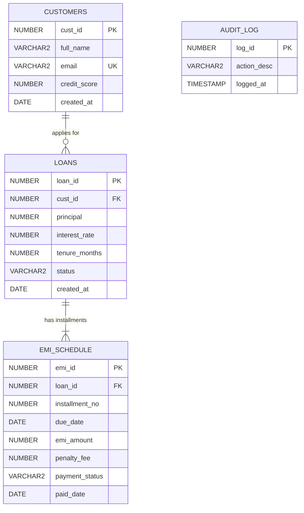

# Loan EMI & Automated Repayment Management System (Oracle SQL / PL/SQL)

A banking database project built with **Oracle SQL and PL/SQL** that automates loan creation, reducing-balance EMI schedule generation, payment processing, overdue penalty calculation, and audit logging.

## Entity-Relationship Diagram



## Features
- **Relational Schema with Integrity Constraints:** Enforces credit score limits (300-900), positive loan principals, and valid payment statuses.
- **Modular PL/SQL Package (`pkg_loan_mgmt`):**
  - `calc_emi`: Computes monthly installments using the standard reducing-balance interest formula.
  - `create_loan_with_schedule`: Creates a loan record, validates customer credit eligibility, and auto-generates monthly installment rows.
  - `pay_emi`: Processes installment payments and automatically closes the loan once all EMIs are paid.
  - `apply_overdue_penalties`: Uses an explicit `FOR UPDATE` cursor to flag missed due dates and apply a 2% late fee.
- **Automated Auditing (`trg_audit_new_loan`):** Logs every newly sanctioned loan into an immutable `AUDIT_LOG` table.

## Project Structure
```text
loan-emi-plsql-system/
├── sql/
│   ├── 01_schema.sql         # Tables, primary/foreign keys, and check constraints
│   ├── 02_package.sql        # PL/SQL package specification and body
│   ├── 03_triggers.sql       # Audit logging and credit validation triggers
│   └── 04_test_scripts.sql   # Sample data, execution blocks, and verification queries
└── README.md                 # Project documentation & ER diagram
```

## How to Run
1. Connect to an Oracle Database instance (Oracle 12c / 19c / 21c XE or Oracle Live SQL).
2. Execute the scripts from the `sql/` directory in numbered order:
   ```sql
   @sql/01_schema.sql
   @sql/02_package.sql
   @sql/03_triggers.sql
   @sql/04_test_scripts.sql
   ```
